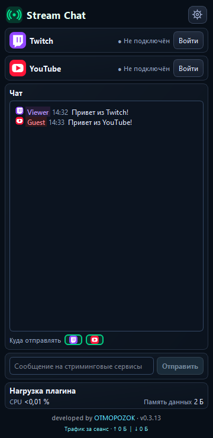

# Stream Chat OBS

**Чаты Twitch и YouTube в одной док-панели OBS.** Плагин работает на вашем компьютере без нашего сервера. [English](docs/README_EN.md).

*Снимок интерфейса 0.3.14 создан в тестовом окружении; сообщения и подключения демонстрационные.* [Английский интерфейс](docs/screenshots/chat-en.png) · [Настройки](docs/screenshots/settings-ru.png).

## Возможности

- Читайте сообщения Twitch и YouTube в одном месте. У каждого сообщения есть компактная метка платформы, цветовой акцент и местное время, когда сервис передал его.
- Пока вы читаете старые сообщения, чат сохраняет положение. Кнопка «↓» покажет число новых сообщений и вернёт к последним.
- Отправляйте текст в Twitch, YouTube или оба подключённых чата. Оба направления выбраны по умолчанию.
- Плагин ищет чат YouTube после запуска эфира и показывает число зрителей во время трансляции, когда сервис возвращает эти данные.
- Если потоковое подключение YouTube не передаёт сообщения, плагин переключается на официальный API чтения чата с ограниченным интервалом запросов.
- Входите через браузер без копирования токенов. Учётные данные остаются на ПК и защищены Windows.
- В настройках есть **Авто / Русский / English** и размер текста с живым образцом. История сообщений хранится только до закрытия OBS.

## Что проверено

- OBS 33 на Windows x64 загружает плагин. Вход в Twitch, реальные сообщения и счётчик зрителей проверены во время эфира на версии 0.3.8.
- Вход в Google через браузер подтверждён. Чтение сообщений через запасной путь YouTube API требует проверки во время реального эфира.
- Версия 0.3.14 проходит автоматическую сборку и тесты интерфейса; резервный путь YouTube ожидает проверки в OBS во время реального эфира.

## Установка

1. Закройте OBS и [скачайте архив последней успешной сборки](https://github.com/DIMI0007/stream-chat-obs/actions/workflows/build-windows.yml).
2. Скопируйте всю папку `stream-chat-obs` из архива в `C:\ProgramData\obs-studio\plugins\`. При обновлении замените папку целиком.
3. Запустите OBS, откройте док-панель **Stream Chat** и войдите в нужные сервисы.

Сборки предназначены для **OBS 33, Windows x64**. Версия и ревизия указаны в `BUILD_INFO.json` внутри архива. Плагин пока не подписан цифровой подписью.

## Поддержать разработку

[DonationAlerts](https://www.donationalerts.com/r/otmopozok) · [DonatePay](https://donatepay.ru/don/OTMOPOZOK)

Разработчик: [OTMOPOZOK](https://www.youtube.com/channel/UCTAKYR3T2Ud8zZgNShgQfyw/).
