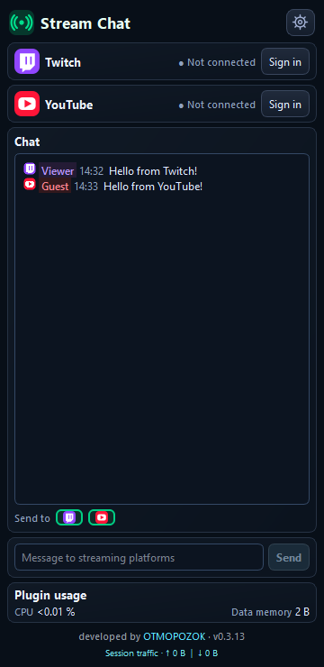

# Stream Chat OBS

**Twitch, YouTube and Kick chats in one OBS dock.** The plugin runs on your computer without a project-operated server. [Русский](../README.md).

*Version 0.4.0 UI preview from an isolated test host; messages and connections are sample data.* [Russian interface](screenshots/chat-ru.png) · [Narrow dock](screenshots/chat-narrow-ru.png) · [Settings](screenshots/settings-en.png).

## Features

- Read Twitch, YouTube and Kick together. Each message has a compact platform marker, subtle color accent, and local time when the service supplies it.
- Scrolling up holds your place. A down button counts new messages and takes you back to the latest ones.
- Send text to selected Twitch, YouTube and Kick chats. Kick is optional and disabled by default.
- YouTube chat discovery starts after the broadcast begins. Viewer counts appear during a stream when the service provides them.
- If the YouTube streaming connection stops delivering data, the plugin switches to the official chat polling API at a limited rate.
- In version 0.4.0, register a personal application for each service, enter its keys in Settings and sign in through the browser. Windows encrypts the saved keys and sign-in data. Each account section links to our [registration guide](REGISTER_APPS_RU.md).
- Settings include **Auto / Russian / English** and text size with a live preview. Message history is cleared when OBS closes.
- Highlight your names, optionally hide named bots, and see when the last chat message arrived.

## How the plugins work together

Version 0.4.0 uses personal developer applications for Twitch, YouTube and Kick. Each account section has a setup guide link. Enable Kick to show its card and green K marker. Kick reading only needs a channel name; sending requires sign-in. Kick reading, sign-in, token refresh and sending were verified with a real account.

Stream Chat works on its own. Stream Stats can read Chat's local CPU, tracked data and traffic counters when installed. Stream Notify may use Chat's saved Twitch and YouTube sign-ins and its Kick channel name to check live status; it does not change Chat's account data.

## Install

1. Close OBS and [download the latest successful build](https://github.com/DIMI0007/stream-chat-obs/actions/workflows/build-windows.yml).
2. Copy the entire `stream-chat-obs` folder into `C:\ProgramData\obs-studio\plugins\`. Replace the whole folder when updating.
3. Start OBS, open the **Stream Chat** dock, and sign in to the services you use.

Target: **OBS 33, Windows x64**. `BUILD_INFO.json` in the archive identifies the version and source revision. The build is currently unsigned.

Live YouTube chat still needs verification during a real broadcast.

## Support the project

If these plugins help your streams, please consider a donation. Your support helps improve the plugins, fix issues and fund future development.

[Support via DonationAlerts](https://www.donationalerts.com/r/otmopozok) · [Support via DonatePay](https://donatepay.ru/don/OTMOPOZOK)

Developed by [OTMOPOZOK](https://www.youtube.com/channel/UCTAKYR3T2Ud8zZgNShgQfyw/).
